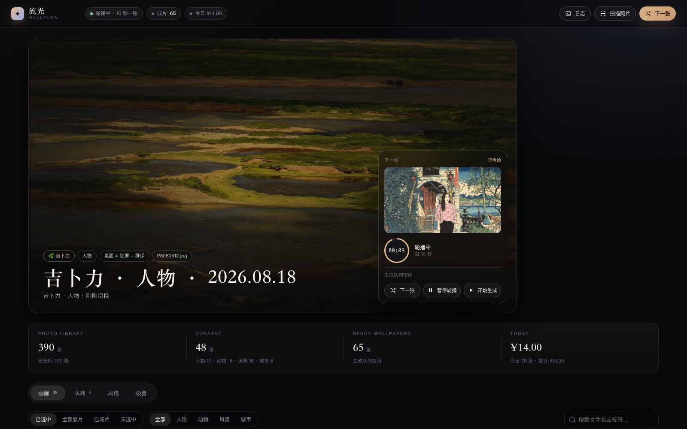
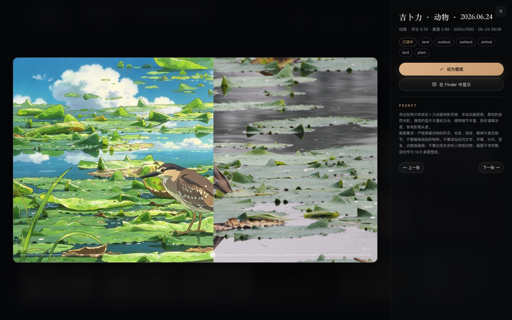
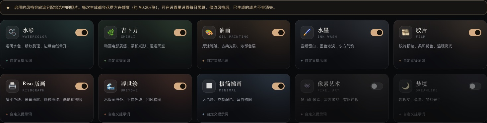
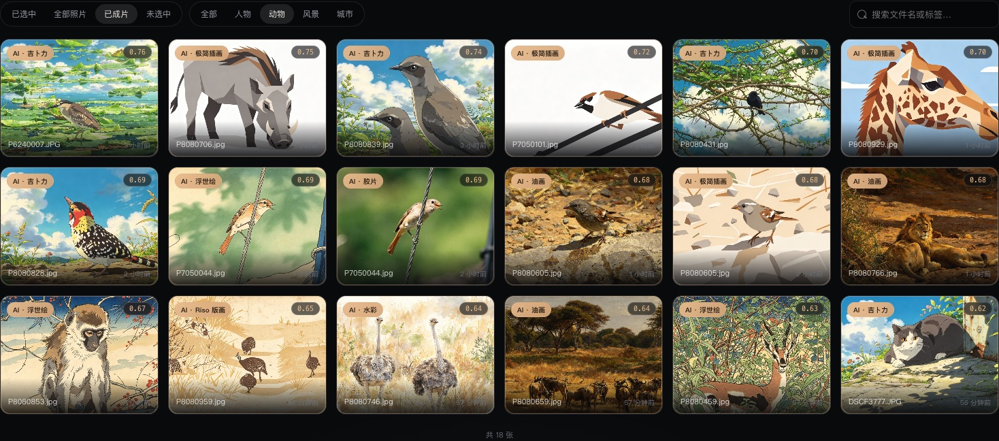
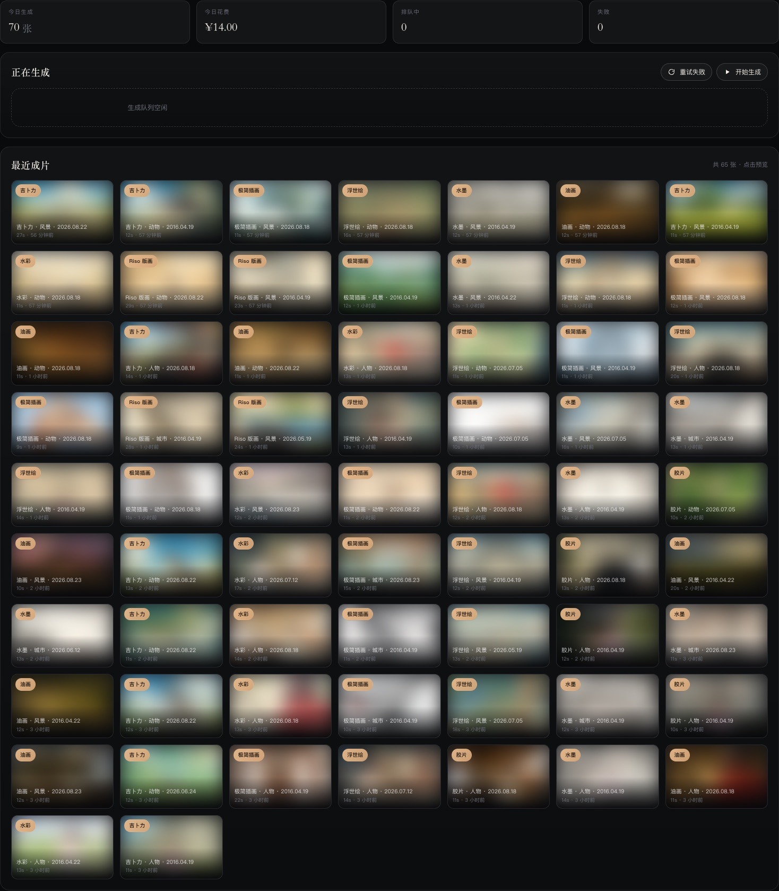
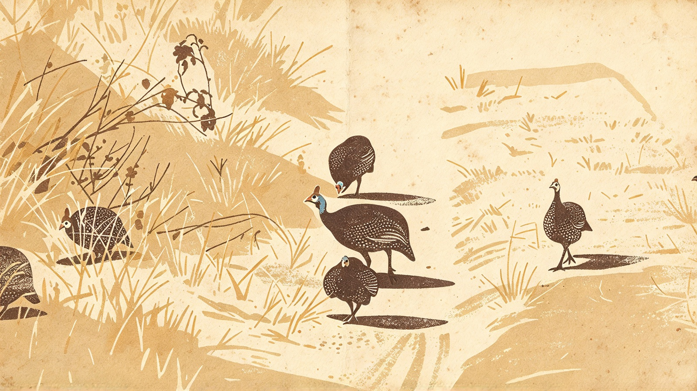

# 流光壁纸 · Wallflow

[](https://github.com/Eagerlytofly/wallflow/actions/workflows/test.yml)
[](LICENSE)

> 把散落在硬盘里的照片，变成会呼吸的 macOS 壁纸。
> 本地选片 → 火山方舟风格化 → 桌面 + 锁屏随机轮播，**播放和生成始终并行**。



---

## 它解决什么问题

硬盘里躺着几千张照片，但桌面壁纸永远是那张默认的雪山。传统「幻灯片」壁纸只是原图轮播，
构图、光线、风格都不统一，人也容易被照片里杂乱的背景分心。

流光壁纸做了三件事：

1. **在本地挑出真正适合当壁纸的照片**——Apple Vision 判断主体、人脸、美感分、清晰度、
   是否截屏；不联网、不花钱、不上传。
2. **用火山方舟 Seedream 逐张重绘**——水彩、吉卜力、油画、水墨、胶片、Riso 版画……
   保留构图和人物特征，把照片变成画。
3. **边生成边轮播**——每完成一张就进入候选池，轮播只消费「已完成」的成片，
   永远不会卡在生成上；同时还会接管锁屏，开盖即是风景。

---

## 界面

| 对比原片 / 成片 | 风格与提示词 |
| --- | --- |
|  |  |

| 画廊（48 张入选，每张带评分与分类） | 生成队列 |
| --- | --- |
|  |  |

---

## 快速开始

### 0. 环境要求

- macOS 14+（美感评分需要 macOS 15+；低版本会自动降级为中心评分）
- Node.js ≥ 20.11
- Xcode Command Line Tools（用于编译两个原生小工具：Vision 分析、壁纸写入）
  ```bash
  xcode-select --install
  ```
- 火山方舟 API Key，并在控制台**开通**图像模型（见下方「模型与地域」）

### 1. 安装

```bash
cd wallflow
npm install
```

### 2. 配置 API Key

```bash
cp .secrets/volcengine.env.example .secrets/volcengine.env
# 编辑 .secrets/volcengine.env，填入 ARK_API_KEY=...
```

也可以直接用环境变量 `ARK_API_KEY`。

> 方舟是**按模型**开通的：Key 能用 ≠ 这个模型能用。到
> [控制台 → 开通管理](https://console.volcengine.com/ark/region:ark+cn-beijing/openManagement)
> 勾选 `doubao-seedream-4-0-20260415`（本项目默认，约 8-20 秒/张）。

### 3. 指定照片目录

编辑 `config.json`（首次运行会自动生成）的 `roots`：

```json
{
  "roots": [
    "/Users/you/Pictures/2026",
    "/Volumes/photo/旅行"
  ]
}
```

支持 JPG / PNG / HEIC / WebP / TIFF；RAW 默认跳过（首次扫描太慢，可在 `scan.includeRaw` 打开）。

### 4. 扫描 + 选片

```bash
npm run scan
```

一次扫描约 1-2 分钟 / 400 张：生成缩略图、感知哈希去重、清晰度/曝光/色彩分析、
Vision 分类与人脸检测、美感评分，最后按配额和多样性选出 48 张。

### 5. 启动控制台

```bash
npm start
# → http://127.0.0.1:7799
```

打开页面：

1. 点右上角 **开始生成**（或英雄区「开始生成第一张」）；
2. 第一张成片完成后自动成为桌面 + 锁屏壁纸；
3. 之后按设定间隔换一张（默认 30 分钟，可调到 10 秒；设为 0 则关闭自动轮播）；
4. 随时可以「下一张」（快捷键 `N`）「暂停轮播」「暂停生成」，互不影响。

---

## 工作原理

```
 照片目录
   │  扫描：sips / sharp 解码，HEIC/RAW 走 ImageIO
   ▼
 缩略图 + dHash + 清晰度 / 曝光 / 色彩
   │
   ▼
 Apple Vision（本地 · 免费 · 不上传）
 分类标签 / 人脸框 / 美感分 / 显著性区域 / 文字量
   │
   ▼
 选片：配额 + 标签多样性 + 近重复剔除 → 48 张
   │
   ├─────────────── 并行 worker（默认 2） ───────────────┐
   │  智能裁切 16:9 → Seedream 图生图 → 4K 成片          │
   └─────────────────────────────────────────────────────┘
   │
   ▼
 成片库（data/wallpapers/<photoId>.<styleId>.jpg）
   │
   ▼
 轮播调度：只消费「已完成」的成片（每 N 秒；锁屏/休眠时暂停）
   │
   ├─ NSWorkspace 快速换桌面（~10ms，不闪）
   │
   └─ 写 Index.plist（Desktop + Idle）
        └─ 锁屏瞬间重启一次 WallpaperAgent → 锁屏同步
```

### 选片打分

每张照片的分数（0–1，完全透明，UI 里可见）：

| 因子 | 权重 | 说明 |
| --- | --- | --- |
| 美感分 | 0.40 | Apple Vision `CalculateImageAesthetics` |
| 清晰度 | 0.18 | 拉普拉斯方差（对数归一化） |
| 分辨率 | 0.10 | 以百万像素对数缩放 |
| 色彩丰富度 | 0.08 | Hasler–Süsstrunk 指标 |
| 曝光 | 0.08 | 偏离中间调扣分 |
| 分类加成 | 0.10 | 风景/动物略高于人物，城市最低 |
| 人脸质量 | 0.06 | 人脸面积与 captureQuality |
| 惩罚 | — | 截屏 −0.35、大量文字 −0.1~−0.3 |

硬性门槛：短边 ≥1200、≥1.2MP、清晰度 ≥0.06、非 `isUtility` 截屏、文字 <260 字符。
之后按**分类配额**（人物/动物/风景/城市）和**标签 Jaccard 相似度**挑出多样化的一组；
dHash 距离 ≤5 视为连拍/重复，只保留分高的一张。

### 风格

| 风格 | 一句话 | 适合 |
| --- | --- | --- |
| 水彩 | 透明叠色、纸纹、边缘自然晕开 | 人物、风景 |
| 吉卜力 | 动画电影质感、柔和光影、通透天空 | 动物、风景 |
| 油画 | 厚涂笔触、古典侧光 | 风景、静物 |
| 水墨 | 宣纸留白、墨色浓淡 | 山水、建筑 |
| 胶片 | Portra 颗粒、轻微褪色 | 人物、街拍 |
| Riso 版画 | 扁平色块、米黄纸底、颗粒纸纹、低饱和拼贴 | 人物、动物、风景 |
| 浮世绘 | 木版线条、平涂色块 | 动物、风景 |
| 极简插画 | 几何概括、克制配色 | 建筑、静物 |
| 像素艺术 | 16-bit 复古色板 | 趣味 |
| 梦境 | 柔焦、光尘、超现实 | 氛围 |



> 旧版内置的「赛博朋克」已经被 Riso 版画取代；已经生成的 5 张赛博朋克成片没有删除，
> 而是移动到了 `data/archive/`，不再参与轮播。已选照片中原本分配赛博朋克的会自动改配 Riso。

每种风格都附一段**主体保留指令**（例如人物：面部特征、发型、服装不变；动物：毛色与斑纹不变），
再加统一的“不要文字/水印/边框，适合 16:9 壁纸”。风格可单独关闭、调整自定义提示词。

### 播放与生成为什么是并行的

- `Scheduler` 只读取 `status = done` 且文件存在的成片；成片不足时宁可继续显示当前壁纸，也不阻塞。
- `Pipeline` 是独立 worker 池：完成一张 → 写入成片库 → 插入播放列表的随机位置 →
  下一轮就可能出现。**不需要等 48 张全部跑完。**
- 两者共享一个 store，但只在内存里读；磁盘写是防抖 + 原子替换，进程被杀也不会写坏状态。
- 断点续跑：`runtime.pipelineRunning` 会持久化，重启服务后自动恢复未完成任务；
  已完成的成片按 `(photoId, styleId)` 幂等跳过。

---

## 换壁纸：10 秒一张，而且不闪

macOS 有两条完全不同的换壁纸通道，本项目两条都用：

| 通道 | 代价 | 用来做什么 |
| --- | --- | --- |
| `NSWorkspace.setDesktopImageURL` | ~10 ms，**无闪烁** | 每次轮播换桌面 |
| 改 `Index.plist` + `killall WallpaperAgent` | ~0.7 s，**会黑闪一下** | 锁屏配置变更 |

### 桌面与锁屏联动（关键）

macOS 的锁屏默认可能是一张单独的壁纸。要让锁屏跟着轮播走，本项目会打开系统设置里的
**「桌面与锁屏使用同一张壁纸」**：

```bash
# 对应这个用户设置（helper 会自动写入）
defaults read com.apple.wallpaper useAsDesktopWallpaperAndIdleWallpaper
# → 1
```

开启后，壁纸存储里只保留 `Idle` 一节，桌面和锁屏共用它：

```
~/Library/Application Support/com.apple.wallpaper/Store/Index.plist
  └─ AllSpacesAndDisplays
       └─ Idle → com.apple.wallpaper.choice.image → Files[relative] = 成片路径
```

轮播流程：

1. 每 N 秒用 `NSWorkspace` 换桌面（默认 10 秒，最小 5 秒）；
2. 同时把同一张图写进 `Idle`（不重启 agent），保证锁屏配置与桌面一致；
3. 检测到屏幕锁定/休眠时暂停轮播，并在**锁定瞬间**重启一次 WallpaperAgent，
   让锁屏重新读取最新 `Idle`——这一下闪烁发生在锁屏过程中；
4. 解锁后 1.5 秒恢复轮播，锁定期间不浪费 CPU。

`native/Wallpaper.swift` 用 `PropertyListSerialization` 读写二进制 plist（嵌套的
`Configuration` 也是 plist），会自动清掉二进制 plist 不支持的 `NSNull`，并补上锁屏
图像需要的 `backgroundColor`。

### 锁屏不跟着变怎么办

按顺序试：

1. 控制台 → 设置 → **修复锁屏联动**（或终端 `npm run unify`）——重新写入
   `useAsDesktopWallpaperAndIdleWallpaper=1` 并重启 agent；
2. 打开「系统设置 → 墙纸」，确认当前壁纸的「显示在」是 **桌面与锁屏**（不是仅桌面）；
3. `npm run doctor` 应显示 `桌面与锁屏已联动`；
4. 如果你锁屏后看到的是**屏保动画/风景视频**，那是 macOS 屏保（Aerial），和锁屏壁纸
   是两套机制——到「系统设置 → 锁定屏幕」把屏保换成「无」或其它，或者在屏保设置里
   关闭「显示为壁纸」；
5. 手动锁定（`Control-Command-Q`）会立即使用最新桌面；合盖/空闲锁屏可能沿用上一次的
   锁屏快照，这是 macOS 自己的缓存。

锁屏同步模式（设置页 / `config.json` → `wallpaper.lockScreenMode`）：

| 模式 | 行为 | 适合 |
| --- | --- | --- |
| `on-lock`（默认） | 桌面与锁屏联动，锁定时读取最新桌面 | 10 秒级快速轮播 |
| `each` | 每次换壁纸都重启 agent 同步锁屏 | 调试/慢轮播（短间隔会闪） |
| `off` | 只换桌面，锁屏保持原样 | 不想动锁屏 |

- 首次运行会把原始配置备份到 `data/wallpaper/original.plist`。
- 控制台「恢复原始壁纸」或 `npm run restore` 可一键还原（并恢复原来的锁屏独立设置）。
- **权限**：写入锁屏配置需要「完全磁盘访问权限」（终端 / iTerm / 或 launchd 启动的 node）。
  系统设置 → 隐私与安全性 → 完全磁盘访问权限 → 加入你的终端或 `which node`。
  没有权限时体检会明确报错；桌面快速通道不受影响，只是锁屏不会更新。

---

### 画廊的「已成片」

- **已成片**：按**成片**展示，一张照片如果生成过多个风格，会出现多张卡片（例如同一张人物的水彩和油画）；
- **已选中**：仍按**照片**展示，每张照片只显示当前分配风格的那一张；
- 卡片角标会写明风格，点开对比页也只能看到该风格的成片，可直接设为壁纸。

### 手动下一张 / 关闭自动轮播

- 控制台顶栏、首页右侧、设置页都有 **「下一张」** 按钮，点一下立即换；
- 页面内按 **`N`** 也可以切下一张（输入框里打字时不会触发）；
- 设置里的间隔填 **0**（或点快捷按钮「关闭轮播」）→ 关闭自动轮播，壁纸保持不变，
  但「下一张」/ `npm run next` 仍然可用；
- 想恢复自动轮播，把间隔改回 10、30 等正数并保存即可。

---

## 屏保

macOS 15 的屏保已经并入「壁纸扩展」体系：`ScreenSaverEngine` 不再加载第三方 `.saver`，
而是播放系统壁纸内容（我们实测设置 `moduleName` 会被忽略）。所以屏保的做法是**复用同一张壁纸**：

```bash
defaults read com.apple.wallpaper useAsDesktopWallpaperAndScreenSaverWallpaper
# → 1
```

打开后：

- 每次屏保启动时，取**当前桌面壁纸**作为屏保画面；
- 桌面每 10 秒轮播，所以每次进屏保看到的 AI 成片会不同；
- 屏保**运行期间**不会每 10 秒跳一张——系统只在启动时取一次画面。要做到这一点需要
  自建视频壁纸扩展（类似 Aerial 4），属于后续工作，不是改 plist 能解决的；
- 如果你的屏保仍然是固定的 Aerial 风景，到「系统设置 → 屏保」里选择「当前壁纸/随机」，
  或关掉屏保；`npm run doctor` 会显示桌面/锁屏/屏保的联动状态。

---

## 命令

```bash
npm start                 # 控制台 + 轮播 + 生成队列（前台）
npm run scan              # 扫描 & 选片
npm run style -- --limit 8  # 命令行批量生成 8 张
npm run next              # 立即切到下一张（轮播关闭时也有效）
npm run doctor            # 体检（含模型可用性探测）
npm run restore           # 恢复原始桌面/锁屏

node bin/wallflow.mjs apply <renderKey>   # 指定成片
node bin/wallflow.mjs status              # 状态速览
node bin/wallflow.mjs config              # 配置路径
```

### 开机自启

```bash
./scripts/install-launchd.sh     # 安装 LaunchAgent（登录后自启，崩溃自动拉起）
./scripts/uninstall-launchd.sh   # 卸载
tail -f data/daemon.log
```

> launchd 启动的进程不在终端授权范围内，需要把 node 可执行文件加入「完全磁盘访问权限」，
> 否则锁屏写入可能失败（桌面壁纸不受影响）。

---

## 配置说明（config.json）

| 字段 | 默认 | 说明 |
| --- | --- | --- |
| `roots` | 示例目录 | 照片根目录数组，递归扫描 |
| `scan.maxFiles` | 600 | 单次扫描上限（按修改时间取最新） |
| `scan.includeRaw` | false | 是否处理 ORF/CR2/NEF 等 RAW（sips 解码较慢） |
| `scan.minWidth` | 1200 | 更窄的照片直接淘汰 |
| `scan.minMegapixels` | 1.2 | 同上 |
| `scan.concurrency` | 3 | 解码并发 |
| `scan.skipScreenshots` | true | 跳过截屏/文档类 |
| `selection.count` | 48 | 入选数量 |
| `selection.minScore` | 0.42 | 入选最低分 |
| `selection.quotas` | 16/16/16/8 | 人物/动物/风景/城市 目标数量（软配额） |
| `ark.model` | seedream-4-0-20260415 | 图生图模型 |
| `ark.fallbackModels` | 5.0 pro / 5.0 flash | 主模型不可用时自动回退 |
| `ark.size` | 2560x1440 | 送给模型的 16:9 输入尺寸 |
| `ark.concurrency` | 2 | 并发生成数（方舟限流时调低） |
| `ark.priceCents` | 20 | 单张估算成本（分），只用于预算 |
| `ark.dailyBudgetCents` | 800 | 每日预算（分），到点自动暂停 |
| `output.width/height` | 3840×2160 | 最终壁纸分辨率（从模型输出 Lanczos 放大） |
| `rotation.intervalSeconds` | 1800 | 轮播间隔（秒）；0 = 关闭自动轮播，只用「下一张」手动切换 |
| `rotation.applyOnStart` | true | 启动后是否立即应用第一张 |
| `wallpaper.lockScreenMode` | on-lock | on-lock 锁屏时同步 / each 每次都同步（会闪）/ off 仅桌面 |
| `wallpaper.placement` | 1 | 0 自动 / 1 填充 / 2 适应 / 3 拉伸 / 4 居中 / 5 平铺 |
| `server.port` | 7799 | 仅监听 127.0.0.1 |

---

## 模型与地域

方舟的坑比想象中多，项目内置了探测：

```bash
npm run doctor
```

- `ModelNotOpen`：模型存在但没开通 → 控制台「开通管理」勾选；
- `InvalidEndpointOrModel.NotFound`：模型 ID 已下线，或开通在**另一个地域**；
- 地域：北京 `ark.cn-beijing.volces.com`、上海 `ark.cn-shanghai.volces.com`，
  开通记录在哪个地域就只能用哪个地域的域名。
- 本项目实测可用（2026-10）：`doubao-seedream-4-0-20260415`、`doubao-seedream-5-0-pro-260628`、
  `doubao-seedream-5-0-flash-260915`。5.0 Pro 质量更高但一张约 90 秒，适合不赶时间的批量模式；
  默认 4.0 约 8-20 秒，更适合边播边生成。
- 修改 `ark.size` 可调整模型输入；`output` 才是最终 4K 尺寸。比例建议保持 16:9。

---

## 成本控制

- 每张按 `ark.priceCents` 计入当日花费，达到 `dailyBudgetCents` 自动暂停队列（进行中的会完成）。
- 控制台实时显示今日张数与花费；`dailyBudgetCents: 0` 表示不限。
- 幂等：同一张照片 + 同一风格只生成一次；重复点「开始生成」不会重复扣费。
- 先用 `npm run style -- --limit 3` 试风格，再放开跑。

---

## 故障排查

| 现象 | 原因 / 处理 |
| --- | --- |
| 扫描 0 张 | 目录未挂载 / 扩展名不支持 / `scan.maxFiles` 太小；看日志 |
| 全部「无法解码」 | 空文件或损坏文件；本工具已跳过 <1KB，仍失败会打印文件名 |
| 首次启动很慢 | 正在 `swiftc` 编译两个原生小工具（约 5-10 秒，之后复用） |
| 锁屏没变 | 默认只在锁屏时同步；想每次都变把 `lockScreenMode` 改成 `each`；并检查完全磁盘访问权限 |
| 桌面没变 | 快速通道失败会回退到 plist 方式；看日志与 `wallflow doctor` |
| 10 秒一张会闪 | 锁屏同步模式改回 `on-lock`（默认），不要用 `each` |
| 模型报 404 | 用 `doctor --probe` 确认模型是否开通；换 `fallbackModels` 里的模型 |
| 生成很慢 / 429 | 把 `ark.concurrency` 调到 1，或换 `seedream-5-0-flash` |
| 人物变脸 | 降低风格强度/换「胶片」这类轻风格；提示词已要求保留面部，但模型仍有随机性 |
| 内容审核未通过 | 输出图被审核拦截（常见误判）。会自动用安全提示词 + 新 seed 重试一次；仍失败可在队列点失败卡上的「重试这张」或换风格，这类失败通常不扣费 |
| 壁纸糊 | 模型输出 2560×1440 再放大到 4K；要更清晰可把 `output` 设为 2560×1440 |

---

## 测试

```bash
npm test
```

33 个单元测试覆盖：评分与淘汰、配额/多样性选片、dHash 去重、分类交错、
风格提示词、轮播洗牌袋、智能裁切（人脸保留 / 16:9 边界）、快速桌面通道 / 锁屏同步模式、成片 key 与成本估算。

---

## 目录结构

```
wallflow/
├── bin/wallflow.mjs          CLI 入口
├── src/
│   ├── app.mjs               组装：store / pipeline / scheduler / 动作
│   ├── server.mjs            HTTP + SSE + 媒体文件
│   ├── scan.mjs              扫描、派生图、Vision、选片
│   ├── image.mjs             解码、dHash、指标、智能裁切、4K 输出
│   ├── vision.mjs            Vision 原生工具桥
│   ├── score.mjs             打分、配额、多样性、分类交错
│   ├── styles.mjs            10 种风格与提示词
│   ├── ark.mjs               方舟客户端、探测、重试、成本
│   ├── pipeline.mjs          并发生成 worker
│   ├── scheduler.mjs         轮播调度
│   ├── playlist.mjs          洗牌袋
│   ├── wallpaper.mjs         桌面/锁屏写入与备份
│   ├── store.mjs             状态持久化（原子写）
│   └── config.mjs            默认配置
├── native/
│   ├── VisionAnalyze.swift   本地分析（分类/人脸/美感/显著性）
│   └── Wallpaper.swift       Index.plist 读写 + WallpaperAgent 重启
├── web/                      控制台（无构建步骤，原生 ESM + SSE）
├── data/                     运行时：state.json、缩略图、成片、备份（gitignore）
├── test/                     单元测试
└── docs/                     截图
```

---

## 隐私

- 选片、分类、美感评分全部在本地完成，照片不出本机。
- 只有**入选的 48 张**会以 2560×1440 JPEG 形式发送给火山方舟做风格化；
  原始照片、EXIF、文件名都不会上传。
- API Key 存在 `.secrets/volcengine.env`（已 gitignore，权限 600）。
- 控制台只监听 `127.0.0.1`，没有对外端口。

---

## Roadmap

- [ ] 多显示器分别轮播（当前统一写入 all displays）
- [ ] 视频壁纸 / Live Photo（用 Seedance 生成 5s 循环）
- [ ] 按时间段切换风格（白天胶片、夜晚 Riso 版画）
- [ ] 菜单栏小工具，不用开浏览器也能换
- [ ] 成片分享 / 导出相册

---

## License

MIT. 见 [LICENSE](LICENSE)。
